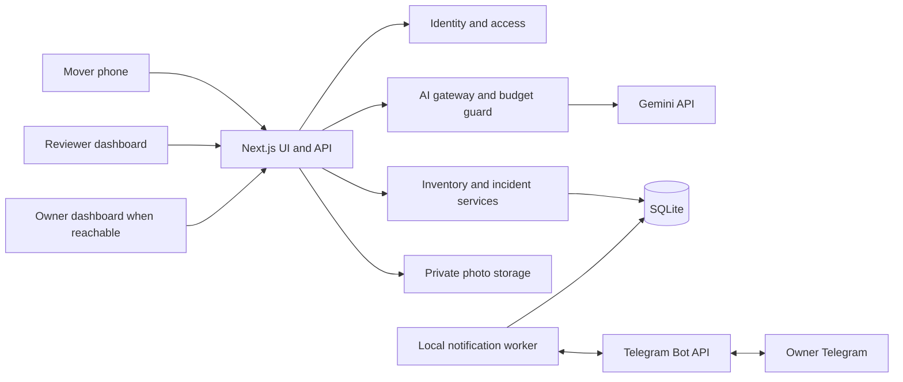

# SayPack — Product Requirements Document

Status: Draft for implementation planning  
Date: 6 October 2026  
Release: Locally hosted MVP  
Context: [SayPack Unified Model Document](README.md)

This PRD defines the proposed product behavior and system design. Targets and defaults below are planning assumptions to validate during implementation and the pilot, not measured performance or promises of production availability. SayPack is a working name.

## 1. Problem Statement

Packing teams need to record many objects while handling them physically. Manual inventory entry interrupts packing, box assignments can become unclear, and reports of damage may lack photographs, timing, or a documented decision. Owners and office reviewers need a common record of what was packed, its reported condition, and what should happen when damage is discovered.

The initial user needs a demonstrable solution without paid platform subscriptions and has approximately S$10 of Gemini credits. The design must therefore prioritize local operation, selective AI use, and a complete manual fallback.

## 2. Solution

SayPack provides a mobile packing interface and a shared inventory dashboard. A mover selects a box and speaks a short command through earphones. Gemini interprets the command and the application validates it, then reads the proposal back. The record is saved only after the mover confirms, and the mover hears "saved" only after the save commits.

When damage is reported, SayPack saves an incident immediately, places the identified item on hold, alerts reviewers, and requests a photograph. AI image assessment supplements the evidence. A reviewer communicates with the owner through Telegram and records the operational decision. Inventory, evidence, responses, and decisions remain linked throughout packing and delivery.

The software enforces recorded workflow restrictions; it cannot physically prevent a mover from handling an item. The interface must make holds prominent and show the next required action.

## 3. Goals, Constraints, and Success Measures

### Goals

- Reduce the effort of recording individually tracked items and finding their boxes.
- Make damage reports actionable without waiting for successful AI analysis.
- Maintain a trustworthy history of observations, evidence, and human decisions.
- Provide consistent access for assigned movers, reviewers, and owners.
- Limit AI usage to the available allowance without introducing paid infrastructure.

### Constraints

- One existing computer hosts the application, SQLite database, private photos, and background worker.
- No paid hosting, database, storage, or speech-service subscription is required for the MVP.
- Gemini is the only planned metered external dependency; its credit eligibility and model must be verified before real calls.
- The initial voice interaction is push-to-talk, not continuous audio streaming.
- Internet access is required for Gemini and Telegram. Local manual workflows must operate without these external services while the host remains reachable.
- Target mover devices are Android phones running Chrome.
- Phone access uses Tailscale (free personal tier): the host and participant devices join one tailnet, and the host is served over Tailscale-issued HTTPS certificates on its tailnet name. This satisfies the browser's secure-context requirement for the microphone without installing a local certificate authority. The app is not exposed to the public internet. Telegram dashboard links work only for recipients whose device is on the tailnet; Telegram remains the owner's primary channel.

### Pilot metrics and provisional targets

| Metric | Target / interpretation |
| --- | --- |
| Correct box assignment | At least 95% in a labeled pilot sample; unresolved commands count separately rather than being guessed |
| Voice recording benefit | Median end-to-end entry time below manual entry on the same device and representative items |
| Incident persistence | Every server-accepted report has a saved incident and reviewer-queue entry, including when AI fails |
| Duplicate action handling | Replaying the same action produces one logical mutation |
| Isolation | All tested unauthorized cross-move reads and writes are denied |
| Dashboard freshness | Committed changes visible within 5 seconds on a reachable pilot network |
| Budget behavior | New AI calls blocked after configured allowance is exhausted; manual workflows remain usable |

Record sample size, noise conditions, devices, model, corrections, and AI usage when reporting pilot results. These targets do not establish real-world damage-detection accuracy.

## 4. Users and User Stories

Roles apply per move. An administrator manages accounts and membership; being an owner does not confer reviewer authority.

1. As an administrator, I want to create a move with source and destination, so that its inventory has a clear context.
2. As an administrator, I want to assign participants and roles, so that each person accesses only their permitted work.
3. As a mover, I want to select my current room and box, so that short commands have explicit context.
4. As a mover, I want to record an item by voice, so that I can reduce typing while packing.
5. As a mover, I want the assistant to clarify ambiguous references, so that it does not change the wrong item.
6. As a mover, I want confirmation of a committed save, so that I know whether to retry.
7. As a mover, I want manual entry and correction, so that I can continue when audio recognition or connectivity fails.
8. As a mover, I want to attach a baseline photo, so that an item's earlier condition can be reviewed.
9. As a mover, I want to report damage before uploading evidence, so that reviewers can respond promptly.
10. As a mover, I want to see an item's hold and instructions, so that I know whether packing may proceed.
11. As a mover, I want to record repacking, so that a reviewer can verify it and release the hold.
12. As a reviewer, I want an incident queue, so that new and unresolved reports are visible.
13. As a reviewer, I want separate mover reports and AI observations, so that I can assess their sources.
14. As a reviewer, I want baseline and incident photos together, so that I can compare visible condition.
15. As a reviewer, I want to request additional evidence, so that unclear reports can be investigated.
16. As a reviewer, I want to notify the owner, so that the owner can understand and respond to the report.
17. As a reviewer, I want to record continue, repack, or escalate decisions, so that the mover receives an accountable instruction.
18. As a reviewer, I want notification failures to remain visible and retryable, so that failed delivery is not mistaken for acknowledgment.
19. As an owner, I want to browse my inventory by box, room, and item, so that I can locate belongings.
20. As an owner, I want to view relevant evidence and decisions, so that I can follow the handling of reported damage.
21. As an owner, I want to acknowledge or respond through Telegram, so that I can participate without requiring remote dashboard access.
22. As a participant, I want arrival observations linked to the same item, so that packing and delivery evidence can be compared.
23. As an administrator, I want usage limits and a remaining-allowance indicator, so that development stays within budget.
24. As an administrator, I want recoverable backups, so that a host failure does not unnecessarily lose inventory and evidence.

## 5. Functional Requirements

P0 requirements are necessary before a real pilot. P1 features may follow the first complete demonstration.

| ID | Priority | Requirement and acceptance condition |
| --- | --- | --- |
| FR-01 | P0 | Authenticate users and enforce per-move roles on every inventory, photo, incident, and decision operation. |
| FR-02 | P0 | Create moves, memberships, rooms, and boxes; reject duplicate box labels within a move. Movers can seal and reopen boxes, with audit history; a sealed box rejects adding, removing, or editing its items until reopened. Reopening is permitted while an item inside is held. |
| FR-03 | P0 | Store individually tracked items with stable IDs; support manual entry, edits, and box reassignment with audit history. |
| FR-04 | P0 | Accept bounded audio clips, obtain structured AI proposals, validate them, and confirm only committed results. |
| FR-05 | P0 | Ask for clarification if required fields or target identities cannot be resolved; stale session context must not silently select a different box. |
| FR-06 | P0 | Require baseline photos before fragile/valuable items can be marked packed; allow optional photos for other items. Fragile and valuable are explicit item flags set by a mover or reviewer; voice interpretation may propose them, but the mover confirms. Adding a flag later makes the baseline requirement apply again. |
| FR-07 | P0 | Persist damage reports before image assessment; support incidents whose item is initially unresolved. |
| FR-08 | P0 | Apply incident-specific item holds when identity is known; reviewers can explicitly apply whole-move holds. |
| FR-09 | P0 | Present image assessment as observations and limitations, separate from the mover report; failure leaves the incident reviewable. |
| FR-10 | P0 | Provide a reviewer queue, evidence requests, owner notification, decision recording, and explicit hold release. |
| FR-11 | P0 | Link Telegram users to authorized owners; support acknowledgments/responses and persist notification attempts. |
| FR-12 | P0 | Search inventory by box, room, and description; show current condition, holds, evidence, and role-appropriate history. |
| FR-13 | P0 | Record arrival observations and open delivery incidents through the same review workflow. |
| FR-14 | P0 | Enforce request limits and an application allowance; exhausted allowance disables AI, not inventory or review. |
| FR-15 | P0 | Resume committed sessions and pending jobs after restart; expose failed jobs and unsaved submissions clearly. |
| FR-16 | P1 | Generate and scan box QR codes with the same server-side authorization as manual selection. |
| FR-17 | P1 | Export a move inventory and incident summary without exposing data from other moves. |

### Operational decision rules

- Continue packing releases only the selected incident's item hold.
- Repack keeps the hold active until repacking is recorded and a reviewer releases it.
- Escalate keeps the hold active pending a later authorized resolution.
- An owner response never automatically releases a hold.
- Existing holds from other incidents or from the whole move remain active.
- Unresolved item identity is prominently flagged; identifying it creates the associated item hold atomically.
- If identity cannot be resolved safely, the reviewer may place a whole-move hold. The system does not guess which item to block.
- Continue and repack decisions require an identified item. Without one, a reviewer may only escalate or resolve with a recorded reason (for example, "not a move item").
- Baseline absence is visible and does not prevent reporting damage.

## 6. Implementation Decisions and System Design

### 6.1 Architecture: modular monolith

Use Next.js, React, TypeScript, Tailwind CSS, SQLite, and private local file storage. Run a separate local Node.js worker for persisted notification jobs and Telegram polling. Both processes use the same local database.

This is a modular monolith: independently understandable application modules in one deployment, with a worker for asynchronous work. It avoids service-to-service networking, distributed transactions, and paid queue infrastructure at the MVP scale.

The database is the source of truth. Model conversation history, the browser's active view, and Telegram messages are not authoritative inventory or approval records.

### 6.2 Module boundaries

| Module | Small public interface | Encapsulated responsibility |
| --- | --- | --- |
| Identity and access | Authenticate, authorize move action | Sessions, roles, move membership, Telegram identity binding |
| Inventory | Record item, assign box, mark packed, list inventory | Box validation, revisions, baseline requirements, audit history |
| Evidence | Upload, attach, retrieve authorized evidence | File validation, storage lifecycle, access checks, photo metadata |
| Incidents | Report, identify item, request evidence, decide, release hold | Incident workflow, independent holds, human authority |
| AI gateway | Interpret command, assess photo | Provider adapter, schemas, context limits, timeouts, usage reservation |
| Notifications | Enqueue event, process job, record owner response | Outbox, retries, leases, Telegram updates and recipient checks |
| Operations | Inspect usage, back up, restore | Budget configuration, worker health, storage checks, recovery |

Provider adapters allow mock Gemini and Telegram implementations without changing business rules. Application services own transactions; the AI and notification adapters do not bypass those services.

Domain modules are plain TypeScript with no dependency on Next.js. Their external dependencies (database handle, Gemini, Telegram, file storage, clock, ID generation) are passed in as interfaces. The Next.js layer uses explicit route handlers rather than Server Actions, because the API contract depends on visible action IDs, expected revisions, and typed outcomes. Each handler stays thin: authenticate, parse and validate input, check the action ID, call one application service, and map the outcome to an HTTP response. The worker imports the same application services, never the route handlers. Tests drive the services directly with fake adapters and a temporary database.

### 6.3 Primary request flows

**Voice inventory command:** authenticate -> resolve explicit session context -> reserve AI allowance -> interpret audio -> validate proposal -> clarify, or persist a pending proposal and read it back -> mover confirms or cancels -> on confirm, execute the inventory operation as a domain command -> commit item/audit/idempotency result -> return saved confirmation.

Every voice proposal requires mover confirmation before it is committed. The mover confirms by tapping large Confirm/Cancel controls, which always work. When the browser supports it, the app also listens briefly for "yes" or "no" with the browser's speech recognition. That spoken reply does not use Gemini. Any other spoken reply is treated as no answer, and the controls stay visible. A rejected proposal is discarded; the mover records again or corrects it manually.

A pending proposal stores its action ID, the validated operation, and the revisions it was validated against. It expires after a configurable period (initially 2 minutes) and is invalidated if its session context changes. At confirmation, the command is revalidated against current state, so a stale proposal returns a conflict instead of committing.

An explicit box named in speech must be reconciled with the active box. If they differ, ask the mover which box is intended. The selected box revision travels with the request so a later UI change does not silently alter its meaning.

**Damage report:** authenticate -> resolve item if possible -> commit incident, applicable hold, audit event, and reviewer notification job -> acknowledge the report -> accept evidence -> attempt AI assessment -> attach result or failure status -> human review.

Manual damage entry bypasses Gemini. A spoken report still depends on successful interpretation; when interpretation fails, display an immediate manual report option. Do not claim the system has recorded a report merely because audio was captured.

**Human decision:** authorize reviewer -> verify expected incident revision -> check transition -> commit decision, hold changes, audit event, and notification job -> publish through dashboard polling and notification delivery.

**Owner response:** receive Telegram update -> deduplicate update -> authenticate linked sender and recipient context -> validate response action -> persist response/audit -> enqueue reviewer notification. Old or forwarded buttons do not confer authority.

### 6.4 Data model and invariants

Core entities: User, Move, MoveMember, Box, PackingSession, Item, ConditionObservation, Photo, DamageIncident, EvidenceRequest, VoiceProposal, AIAssessment, Decision, Hold, OwnerResponse, AuditEvent, NotificationJob, AIUsage, and SubmittedAction.

Fields required by the contracts below, beyond the README's entity table:

- Mutable records (Box, Item, DamageIncident, Hold, EvidenceRequest) carry a revision number.
- SubmittedAction stores a payload fingerprint, status (pending, committed, failed), and recorded outcome.
- AIUsage stores reservation status (reserved, settled, uncertain), reserved estimate, and reconciled usage.
- NotificationJob stores lease owner and lease expiry; a worker state record stores the last durably handled Telegram update ID.
- EvidenceRequest references its incident, requester, request text, status (open, fulfilled, cancelled), and fulfilling photos.

- Each item belongs to one move and at most one current box; the box must belong to that move.
- One item represents one physical object. Bulk quantity tracking is deferred.
- Box labels are unique within a move; human-readable item descriptions are not unique.
- Observations, assessments, decisions, and owner responses preserve their source and timestamp.
- Corrections create history instead of replacing earlier evidence silently.
- A hold references its initiating incident or explicit reviewer action and has its own release record.
- State-changing records have revision numbers for conflict detection.
- Store timestamps in UTC and display them in the user's configured timezone.

Keep lifecycle and holds separate: an item may be packed and still be held. Incident status is coarse: open, escalated, or resolved. Outstanding evidence requests and owner notifications awaiting a response are separate records, so both can be pending at once; the reviewer queue derives badges such as "awaiting evidence", "awaiting owner", and "item unidentified" from them. Evidence requests must not hide incidents from the reviewer queue.

Use foreign keys and constraints where possible, with application checks for cross-record rules. Index move membership, box labels, item move/box associations, incident status, active holds, and due notification jobs. Paginate inventory and history; do not load all photos with each list request.

### 6.5 API contract principles

- Separate bounded AI interpretation requests from domain commands and evidence uploads.
- Every domain mutation includes a unique action ID and, for updates, the expected record revision.
- Replaying an action ID with the same payload returns its recorded outcome; reusing it with a different payload returns a conflict.
- Responses distinguish committed, clarification required, conflict, forbidden, provider unavailable, and allowance exhausted outcomes.
- Photo retrieval requires authorization; physical paths and secrets are never returned.
- Persist pending action status before provider calls so concurrent retries cannot dispatch the same interpretation repeatedly. Ambiguous provider completion must not trigger an automatic blind retry.
- Validate action allowlists and arguments before invoking business services. The AI cannot invoke arbitrary methods or submit an approval.

### 6.6 Consistency and concurrency

Local SQLite transactions provide atomic domain writes. Configure foreign-key enforcement, WAL mode, a bounded busy timeout, and short transactions in both the web and worker processes. External API calls and photo transfers run outside write transactions.

Use the synchronous better-sqlite3 driver. A synchronous transaction function cannot await a network call partway through, so the rule against external calls inside write transactions is structural rather than a convention. Use Kysely as the typed SQL query builder, with versioned plain-SQL migration files applied at startup. Kysely's own execution API is asynchronous, so it is used only to compile queries; better-sqlite3 executes them synchronously. Using Kysely's async transactions would let a transaction await a network call and undo the guarantee above.

Use optimistic concurrency for competing edits and decisions. Reject a stale revision with a conflict and the current state; do not silently overwrite another mover's correction or reviewer decision.

The dashboard is eventually consistent through periodic polling; hold and authorization checks are made against current database state inside the mutation transaction. A stale screen cannot authorize progression.

No distributed cache, read replica, or event-sourcing system is required. Audit records support traceability; they are not the sole mechanism for reconstructing current state.

### 6.7 Transactional outbox and delivery semantics

Save the business event and its notification job in the same transaction. The worker leases due jobs, sends them, and records the outcome. Expired leases become retryable after restart.

Use bounded exponential backoff with jitter; a proposed default is five attempts, honoring provider retry delays. Exhausted jobs stay visible and can be manually retried.

Delivery is at least once: a worker can crash after Telegram accepts a message but before the database records success. Duplicate messages are possible; use stable incident identifiers and make responses idempotent. Do not claim exactly-once external delivery. API acceptance is not proof that an owner read the message.

Persist Telegram update IDs and advance the polling offset only after accepted updates have been handled durably.

### 6.8 Evidence storage consistency

Database transactions cannot atomically commit filesystem writes. Upload to a private staging area, validate and compute a checksum, move to a generated final filename, and then commit metadata. Only committed evidence is exposed to users.

A crash before metadata commit can leave an orphan file; clean up unreferenced staged/final files after a grace period. Missing committed files must be flagged as unavailable evidence, not silently counted as a valid baseline. Avoid user-supplied filesystem paths and validate actual content, not just filename extensions.

### 6.9 Cost and dependency isolation

The AI gateway maintains available allowance, reserved estimated cost, and completed usage. Reserve allowance atomically before dispatch, reconcile available provider usage afterward, and preserve uncertain charges conservatively when request completion is unknown.

Provisional configurable defaults: maximum 20 seconds per audio clip, one active AI request per packing session, and two globally concurrent AI requests. Android Chrome records `audio/webm` (Opus), which the Gemini API lists as a supported input type, so clips are sent without transcoding. The documented audio rate is 32 tokens per second (about 640 tokens for a 20-second clip), and the request limit is 20 MB. Re-verify both against the selected model, and validate image resizing, during implementation.

Set the operational allowance below the verified credit balance to leave a margin. Record pricing currency, conversion assumption, and pricing version; do not treat S$10 as US$10. Application estimates cannot guarantee a provider-enforced billing cap.

Use timeouts and a circuit breaker after repeated provider failures. Manual operations remain independent of Gemini. Telegram failure affects notification delivery, not incident persistence. No paid API calls run in routine automated tests.

## 7. Nonfunctional Requirements

These are pilot design targets under a healthy local host and network.

| Area | Requirement |
| --- | --- |
| Capacity | Plan for 10 concurrent users, 5 active moves, and 1,000 items per move; validate before increasing these limits |
| Local latency | Aim for p95 below 1 second for inventory reads and manual mutations, excluding uploads and external APIs |
| AI latency | Use a configurable timeout, initially 30 seconds; show progress and a recoverable outcome rather than an indefinite spinner |
| Freshness | Poll visible inventory/incident views roughly every 3–5 seconds; back off hidden views |
| Availability | Best effort while the host runs; no production uptime SLA or high availability claim |
| Durability | Accepted records survive process restart; backups address host/disk loss |
| Accessibility | Text confirmation alongside speech, labeled controls, and status conveyed beyond color alone |
| Storage | Monitor free disk space; reject new uploads clearly before exhaustion without blocking manual damage reports |
| Maintainability | Domain modules testable with fake provider adapters and a temporary database |

## 8. Security and Privacy

- Use established session/password primitives rather than custom cryptography. Hash passwords with Argon2id (@node-rs/argon2). Store sessions in SQLite, keyed by a hash of a random token, and send the token in a secure, HTTP-only, SameSite cookie. Check the Origin header on state-changing requests. A full authentication framework is not required: the needs are per-move roles, session revocation, and single-use Telegram linking codes.
- Enforce move membership and action permissions server-side, including background handling of owner responses.
- Store Gemini and Telegram secrets only in server configuration and exclude them from logs and client bundles.
- Serve phone access over Tailscale HTTPS; do not assume a plain LAN address supports microphone capture. Tailnet membership controls network reachability only; application authentication and per-move authorization still apply to every request.
- Chrome's speech recognition, used for yes/no confirmation, may process audio through Google's speech service. Disclose this alongside the Gemini notice.
- Serve private photos through authorized endpoints and limit upload size, type, and filename handling.
- Give users a clear indication when audio/photos will be sent to Gemini. Raw audio is not retained by the application by default; provider processing/retention terms require separate verification.
- Link Telegram identities using a short-lived, single-use code issued within an authorized owner session. Validate every callback against that identity and its current move membership.
- Send only authorized incident information to Telegram; make the external sharing explicit before the reviewer sends evidence.
- Support session revocation and membership removal. A previously sent Telegram message cannot necessarily be recalled, so minimize shared content.
- Define photo retention and deletion rules before a real pilot; exclude credentials, raw media, and complete private transcripts from routine logs.

## 9. Failure Handling and Recovery

| Failure | Required behavior |
| --- | --- |
| Gemini timeout, invalid result, or exhausted allowance | Preserve existing records, show reason, offer manual entry; no false saved confirmation |
| Ambiguous item in damage report | Save unresolved incident, alert reviewer, request identity; do not attach evidence to a guessed item |
| Photo upload or analysis failure | Keep incident visible; allow retry and human review |
| Telegram unavailable | Keep outbox job pending/retryable; dashboard review continues |
| Browser disconnect after commit | Retry with same action ID to retrieve committed outcome |
| Concurrent edit or decision | Reject stale revision and request review of current state |
| Worker crash | Recover expired leases and resume jobs; duplicate external delivery remains possible |
| Host shut down | All clients lose live access; restore service from persistent storage on restart |
| Disk full | Reject upload clearly; preserve safe operations that can still commit; show administrator alert |
| Backup restore | Restore database and associated evidence consistently; inspect recovered jobs before resuming notifications |

For the pilot, back up daily and after major packing sessions. Target recovery to the latest verified backup, at most 24 hours old under that schedule. Perform a restore drill; do not promise a recovery time until it is measured. Use a SQLite-consistent snapshot and a coordinated evidence manifest rather than copying an active database file blindly.

## 10. Observability and Operations

- Structured logs carry request/action ID, actor ID, move ID, operation, duration, and outcome without media or secrets.
- Track AI requests, reserved/estimated usage, provider errors, and remaining application allowance.
- Track incident age, unresolved identities, active holds, notification attempts, and failed jobs.
- Expose administrator diagnostics for database connectivity, worker heartbeat, disk capacity, and latest backup status.
- Surface failure states in the user interface; logs alone do not satisfy notification or save feedback requirements.

## 11. Testing Decisions and Release Gates

Test externally observable behavior and business invariants rather than internal implementation steps. There is no existing application or test suite to use as prior art. The following test scope is proposed for implementation.

- **Inventory:** duplicate actions, box ownership, sealed-box restrictions, baseline evidence, corrections, and concurrent updates.
- **Incidents:** report persists when AI fails, unresolved identity handling, independent holds, role-restricted decisions, and repack release rules.
- **Identity/evidence:** cross-move denial, private photo access, revoked membership, upload validation, and orphan/missing-file handling.
- **Notifications:** transactional job creation, restart recovery, exhausted retries, duplicate updates, and unauthorized or stale Telegram callbacks.
- **AI gateway:** malformed output, ambiguity, timeouts, allowance exhaustion, concurrent reservations, and no automatic approval path.
- **Voice proposals:** nothing commits without confirmation; expired, cancelled, or context-invalidated proposals cannot commit; stale revisions at confirmation return a conflict; double confirmation commits once.
- **End-to-end:** record item -> baseline photo -> report damage -> reviewer/owner interaction -> human decision -> mover instruction -> delivery observation.
- **Device pilot:** real target phones, trusted HTTPS, Bluetooth microphone/speaker routing, speech playback, camera capture, and representative noise.

Release gates: all P0 acceptance conditions pass; permission/hold/idempotency tests pass; a backup can be restored; mock development mode is usable; selected Gemini billing and usage are verified; no routine workflow requires a paid platform subscription.

## 12. Implementation Sequence

| Milestone | Deliverable | Exit condition |
| --- | --- | --- |
| 1. Manual inventory | Authentication, move roles, boxes, items, shared search | Authorized users can record and locate items without AI |
| 2. Damage workflow | Evidence, incidents, holds, reviewer decisions, audit trail | Complete manual report-to-resolution path |
| 3. Voice and budget | Mock adapter, Gemini interpretation, clarification, speech feedback, usage guard | Correct validated saves and manual fallback on failure |
| 4. Visual assistance | Photo assessment and limitations | Assessment failure cannot block review |
| 5. Telegram | Owner linking, outbox worker, responses, retry visibility | Owner can respond and reviewer can decide without remote dashboard access |
| 6. Pilot readiness | Delivery checks, diagnostics, backups, device validation | Release gates and measured pilot workflow completed |

## 13. Out of Scope

- Continuous Gemini Live streaming and always-listening microphone operation.
- Autonomous liability determination, damage guarantees, or automated approval of packing.
- Insurance claims, payment processing, routing, and vehicle tracking.
- Native mobile applications, background audio guarantees, and fully offline AI.
- Public cloud deployment, multi-region availability, distributed databases, Kafka/Redis infrastructure, and Kubernetes.
- Multi-company SaaS billing, bulk quantity tracking, and immutable third-party evidence attestation.

## 14. Tradeoffs and Evolution

| Decision | Benefit | Limitation / change trigger |
| --- | --- | --- |
| Local single host | No hosting subscription; simple operations | Host/network failure affects everyone; revisit when remote field access is required |
| SQLite | Low setup cost; transactional correctness | One writer at a time; consider PostgreSQL when sustained contention or multiple app hosts are measured |
| Short voice commands | Bounded cost and explicit intent | Less fluid than conversation; revisit after latency/cost/noise measurements |
| Confirm every voice proposal | No unintended commits from misheard commands | Extra step per item; yes/no runs in the browser, with no Gemini call, to limit cost and delay |
| Tailscale for HTTPS and reach | Trusted certificates and remote access without a public port or subscription | Every participant device must join the tailnet; revisit if owners need access without installing Tailscale |
| Dashboard polling | Simple reconnect behavior | Slight delay and repeated reads; consider server-sent events if measured demand warrants it |
| Local private photos | No storage service cost | Disk and backup responsibility; revisit when volume or remote deployment requires object storage |
| Persisted notification jobs | Restart-safe delivery without a queue service | Possible duplicate external messages; retain idempotent responses |

## 15. Further Notes and Open Decisions

Before using real customer data, settle the Gemini credit type/model, specific Android pilot devices and language support, retention period, and backup destination. Whether an owner acknowledgment must precede a particular reviewer decision is an operational policy to validate; the MVP records both separately and makes no implicit owner approval claim.

This PRD is the implementation-planning reference for requirements and system design. The README remains the broader concept document. Features and defaults described here are proposed, not already implemented.

Provider facts and prices must be checked when implementing integrations:

- [Gemini pricing](https://ai.google.dev/gemini-api/docs/pricing)
- [Gemini billing](https://ai.google.dev/gemini-api/docs/billing)
- [Gemini function calling](https://ai.google.dev/gemini-api/docs/function-calling)
- [Telegram Bot API](https://core.telegram.org/bots/api)
- [SQLite WAL](https://www.sqlite.org/wal.html)
- [SQLite backup API](https://www.sqlite.org/backup.html)
